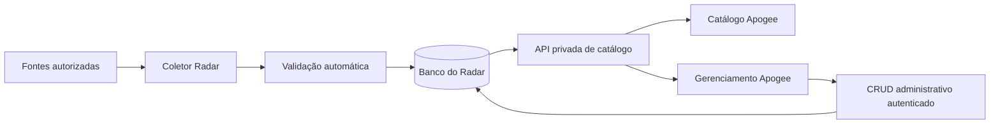

# Radar ao vivo — execução local de 13/10/2026

Status: primeira etapa implementada localmente em `fix/APG-82-radar-admin-bridge`, a partir de `b4ee859919fb73a437c8fee4a2373f74bfa1e2e4`. Nenhuma coleta real, migração remota, publicação, push ou deploy foi executado nesta etapa.

Atualização de 14/10: o proprietário autorizou e foi executada a implantação posterior. Este documento preserva a evidência local original; consulte o [registro de produção](radar-production-20261014.md) para backup, migração, release e validações reais.

## Implementado

- Publicação automática de fichas abertas ou futuras confirmadas, com fonte ativa/verificada, URL permitida, evidência e prazo. Fonte incerta, vencida, suspensa, cancelada ou contraditória fica fora do catálogo. Aprovação humana de fichas e retificações foi retirada.
- Atualização preserva identidade, histórico e campos alterados pelo administrador. Exclusão lógica impede ressurgimento, inclusive quando o título da página muda. URLs anteriores ficam como identificadores auxiliares. Casos de identidade ambígua não são mesclados automaticamente.
- Reconsulta limitada de até duas fichas por execução, dentro do orçamento existente de páginas. Prazo de rechecagem de 24 horas; falha retenta em uma hora sem alegar nova verificação. Fontes com trabalho pendente voltam em cinco minutos. O agendador continua respeitando fontes autorizadas, robots e limites.
- API privada de catálogo v3, com a mesma consulta e regras de visibilidade para público e gerenciamento. O administrador recebe também versão, fonte e evidências; a API pública não expõe auditoria ou credenciais.
- `GET/POST/PATCH/DELETE /api/internal/editorial/opportunities`: listar catálogo ao vivo, criar, editar e excluir; credencial administrativa dedicada, limite de corpo, validação no servidor, transação e conflito de versão.
- `/admin/radar`: catálogo comum, formulário de criação/edição e exclusão; configuração de fontes em vista separada. `/admin/curadoria` redireciona para esse gerenciamento. As ações antigas de aprovação não publicam mais.
- `/oportunidades` e `/membros/oportunidades`: catálogo completo da API, sem mistura com o arquivo estático. Mesmos cartões, filtros e dados do gerenciamento. Data e hora da verificação, com distinção entre consulta automática e atualização administrativa.
- Leitura sem cache persistente, renovação em abas visíveis a cada 60 segundos e ao retornar à aba. Formulários não recebem essa renovação enquanto são editados; seus campos controlados preservam a entrada quando o servidor retorna erro.
- Migração `0007_automatic_live_catalogue.sql`: procedência de verificação, origem da ficha, versão, exclusão, campos preservados, eventos de auditoria e políticas de leitura. Preserva publicações humanamente verificadas anteriores; não promove pendências antigas.

## Verificação

- Radar: 102 testes aprovados; incluem PostgreSQL local PGlite com todas as migrações e papel sem privilégio de superusuário nas leituras/mutações. Cobrem paridade público/admin, publicação, retificação, consulta sem mudança, conflitos, exclusão, títulos/URLs alterados, múltiplos programas manuais na mesma página, restrições de fonte e falha de rede.
- Apogee: 223 testes aprovados; autorização de ações, ator derivado da sessão, criação/edição/exclusão, erros e contrato de integração.
- Typecheck dos dois projetos; lint do Radar sem problemas e da Apogee sem erros, com aviso anterior em `components/gallery/gallery-admin.tsx:81` sobre ``.
- Interface local compilada pelo Next dev: cartões e filtros exercitados em desktop e viewport de 390 px, sem transbordamento horizontal. Programa nacional permanece ao filtrar outra UF; ficha local sai. Retirada e retorno no servidor fictício refletem na página ao renovar a aba.
- Formulário administrativo inspecionado visualmente em página temporária com dados fictícios. A página foi removida. Não houve sessão administrativa real ou submissão de CRUD pelo navegador; a persistência e a autorização foram testadas no banco isolado e nos testes de ações.
- Servidores locais e página temporária de teste encerrados/removidos. Nenhum dado fictício foi enviado ao banco real. Build de produção, CI remoto e integração em produção não fazem parte da evidência desta etapa.

PGlite foi adicionado apenas como dependência de desenvolvimento para testar SQL/RLS sem Docker; documentação: [PGlite — execução local e consultas](https://pglite.dev/docs/).

## Limites e próximas fases

A extração automática continua baseada nos adaptadores HTML/RSS, com PDF de detalhe e padrões de português/datas brasileiras. Busca Web ampla, adaptadores multilíngues, tradução, identidade completa por programa/edição entre fontes, novas taxonomias/filtros, busca em linguagem natural, ranking, calendário e recursos pagos permanecem na evolução descrita no [PRD](radar-prd.md) e no [brief integral](radar-product-brief.md). Seis versus sete categorias continua em avaliação.

Páginas que representam vários programas exigem identidade explícita: cadastro manual pode manter títulos distintos no mesmo URL; coleta automática ambígua não decide qual ficha substituir. A política de envelhecimento máximo de verificações e o SLA de cobertura por fonte ainda precisam ser definidos; falha de rede mantém o último estado conhecido e seu horário, sem inventar encerramento. Limites de lote não equivalem a garantia de checagem diária de todo o catálogo.

O CSV legado não fornece estado comprovado de inscrições. Suas entradas ficam como dados incompletos até reconsulta automática válida; o formulário administrativo estruturado publica imediatamente ao salvar dados válidos. Registros estáticos antigos não são promovidos: eventual importação precisa conferir fonte e prazo.

## Sequência para implantação posterior

1. Selecionar o SHA de release após integrar esta etapa com a base vigente dos dois serviços e as alterações de blog/SEO em outras branches. Esta branch não prova integração com essas versões.
2. Com autorização específica para banco e publicação, inventariar serviços, schema aplicado e backup; pausar o agendador durante a troca. Confirmar papel do banco, políticas e acesso ao novo histórico. Não alterar segredos, DNS ou infraestrutura por consequência desta mudança.
3. Aplicar a migração 0007 pelo mecanismo existente e publicar Radar e Apogee de forma coordenada. O contrato agora é v3 e a antiga rota de aprovação virou CRUD; misturar versões pode deixar o catálogo indisponível. Não executar a implantação de um serviço supondo que o outro já foi atualizado.
4. Validar saúde dos dois serviços, credenciais separadas, leitura pública/admin com os mesmos IDs, campos privados ausentes na resposta pública, novas datas e estado vazio/indisponível. Validar CRUD com dados isolados em ambiente de teste; não cadastrar oportunidades fictícias em produção.
5. Retomar o agendador somente após validação. Conferir uma execução persistida, seus contadores e a data de consulta da fonte. Publicação só é comprovada pela leitura efetiva na Apogee.
6. Em falha, pausar a coleta e reverter os dois serviços juntos. A migração é aditiva, mas o código antigo não lê fichas automáticas sem `human_verified_at`; um rollback pode ocultá-las. Não apagar eventos, fichas ou colunas para simular reversão. Avaliar restauração das políticas e do backup conforme o ponto real de falha.
