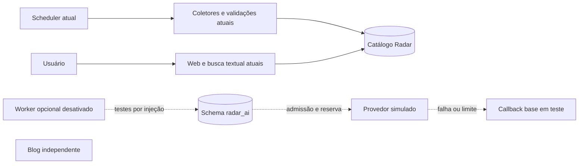

# Radar — primeira entrega local da fundação mensal

Data: 14/11/2026. Escopo autorizado: começar Radar pelo plano, preservar blog e
operação sem API, sem deploy ou chamadas OpenAI. Esta entrega inicia R0–R3; não
declara o PRD ou esses quatro gates integralmente concluídos.

## Baseline verificado no checkout

- Base: `d6a422d8207cb04eefe9819c082f948dc5a4de30`, referência local `origin/main`.
  Não se trata de comprovação de SHA em produção ou de fetch remoto desta entrega.
- Branch isolada: `feat/radar-monthly-foundation-20261114`.
- Runtime base: `web`, `scheduler`, PostgreSQL próprio e ponte HTTP existente.
- Scheduler: `scripts/run-scheduled-ingestion.mjs`; não alterado.
- Banco base: migrações 0001–0049; candidato 0050 cria apenas schema/papéis de IA.
- Busca/consumidores/editor/publicação/fontes atuais: nenhuma alteração.
- Blog: nenhuma alteração de código, configuração, dados ou containers.

Dependências locais foram reutilizadas por symlink de uma instalação existente,
com mesmo SHA-256 de package-lock. Não houve instalação ou alteração no destino.
Essa conveniência de teste não é configuração de release.

## Entrega e evidência

| Etapa | Entregue neste candidato | Limite da evidência |
| --- | --- | --- |
| R0 | Baseline local e fronteiras mapeadas | Sem inventário VPS, saldo ou preços reais |
| R1 | Serviço opcional e imagem exclusivos; papel de banco restrito | Sem teste de containers/rede em execução; fila/propostas futuras |
| R2 | Ledger persistente, reservas atômicas, tetos e identidade | Comprovação financeira e preços exclusivamente sintéticos |
| R3 | Estados, circuito, retenção, idempotência e dispatcher simulado | Sem transporte ou integração a consultas reais; timeout futuro |

O desenho pontilhado representa módulos exercitados em testes, sem conexão do
executável ao banco/provedor e sem mudança na publicação atual. A rede interna do
Compose não permite egresso OpenAI; liberação futura exigirá decisão explícita e
isolamento apropriado. Não foi alterada a rede para antecipar ativação.

## Invariantes exercitados

Conta/projeto/produto errados, prova vencida, parcela zero ou barreira financeira
ausente impedem admissão. Preço expirado ou modificado, redução de parcela, lease
expirada e troca de ciclo são rechecados antes do envio. Limites de ciclo, dia,
envelope e operação usam microdólares; encargos não delimitáveis são recusados.

Uma operação enviada mantém reserva após timeout, erro ou crash. Repetição da chave
não reenvia. Resultados incertos não podem ser liberados pelo worker. Custo acima
do teto preserva o recibo e pausa somente IA. Crédito esgotado não é confundido com
429 de taxa. Reinício ou dia 1 não criam concessão. Pausa manual não some ao renovar.

## Validação

Todos os comandos Node foram executados pela FIFO global, sem concorrência com
outros trabalhos locais. O servidor que ocupava a fila foi preservado; os testes
aguardaram sua liberação natural conforme decisão do usuário.

| Verificação | Resultado |
| --- | --- |
| `node --test --test-concurrency=1 tests/runtime-compose.test.mjs ai-worker/test/*.test.mjs` | 42/42, sem falhas ou skips; inclui 41 testes novos e renderização do Compose |
| `RADAR_POSTGRES_BIN=/opt/homebrew/opt/postgresql@17/bin node ai-worker/test/postgres-runner.mjs` | 19/19 no PostgreSQL real descartável, com logins separados e duas conexões de worker |
| `node node_modules/eslint/bin/eslint.js ai-worker tests/runtime-compose.test.mjs` | Aprovado, sem avisos ou erros |
| `node node_modules/vitest/vitest.mjs run --maxWorkers=1` com os sete arquivos abaixo | 115/115 regressões aprovadas |
| `git diff --check` e comparação de escopo/dependências/lockfile com a base | Aprovados; sem alteração em código base ou blog |

Arquivos de regressão: `publication-rules`, `scheduled-ingestion`,
`live-catalogue.integration`, `security-boundaries`, `opportunity-bridge`,
`event-monitoring` e `personal-calendar-migration`, em `src/__tests__/*.test.ts`.
As integrações são locais com fixtures, não consultam catálogo de produção.
Logs finais: `/private/tmp/radar-ai-foundation-tests.log`,
`/private/tmp/radar-ai-postgres-tests.log`, `/private/tmp/radar-ai-lint.log` e
`/private/tmp/radar-ai-base-regression.log`.
Cluster descartável encerrado pelo próprio runner, com evidência preservada em
`/var/folders/c4/8pl0mxxs3kq329jkg3n3jr8h0000gn/T/radar-ai-pg-SN3vEd`.

Não foram executados build Next, suíte inteira, build Docker ou containers. O
Compose foi apenas renderizado com credenciais sintéticas; o isolamento de rede e
resiliência sob carga ainda precisam de homologação em execução. As 19 verificações
de banco são repetidas nos dois motores e não devem ser somadas como casos únicos.

Não foram realizados deploy, push, migração em banco existente, inferência,
embeddings, pesquisa paga ou teste real de chave/crédito. Não houve uso de navegador.
Quando necessário futuramente, será usado o navegador interno do Codex.

## Próximas entregas do plano

Concluir os gates locais de R1–R3 (fila/propostas, reconciliação e integração com
timeout), mantendo o transporte desativado enquanto não autorizado. R4 modela
internacional sem IA; R5 incorpora inclusão verificável; R6 melhora busca e filtros.
Containers reais, inventário operacional e comprovação financeira serão evidências
separadas, sem misturar o trabalho com o blog ou antecipar release.
